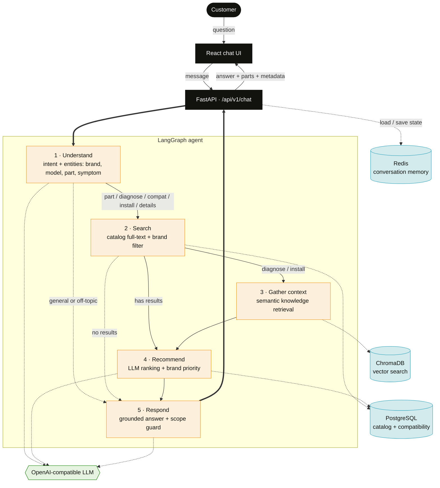

# PartSelect Repair Assistant

A conversational agent for the PartSelect e-commerce experience, scoped to **refrigerator and dishwasher** parts. It helps customers find parts, diagnose symptoms, check whether a part fits their model, and get installation guidance — with prices, stock, links, and compatibility grounded in the PartSelect catalog rather than the language model's memory.

Built with an intent-driven **LangGraph** agent on **FastAPI**, backed by **PostgreSQL**, **ChromaDB**, and **Redis**, with a **React** chat UI.

---

## Overview

Every message flows through a five-node agent that classifies intent, retrieves matching parts and knowledge, ranks them, and writes a grounded answer:

1. **Understand** — LLM intent classification and entity extraction (part number, model, brand, appliance, symptom).
2. **Search** — Postgres full-text search over the catalog, filtered by brand and appliance.
3. **Gather context** — semantic search in ChromaDB for troubleshooting and installation knowledge.
4. **Recommend** — the LLM ranks the candidate parts for relevance.
5. **Respond** — a natural-language answer; prices, stock, and links come straight from the catalog.

Conversation state (appliance, brand, model, part, symptom) is kept in Redis so the agent remembers context across turns.

## Agentic architecture



*Solid arrows are the main path; dotted arrows are conditional routes and backing-service calls. Dark = client/API, amber = agent nodes, blue = data services, green = LLM.*

### Intents

| Intent | What it does |
|---|---|
| `search_part` | Find or browse parts, optionally filtered by brand |
| `diagnose_issue` | Map a symptom to the parts likely to fix it |
| `compatibility_check` | Check whether a part fits a given model |
| `installation_help` | Return the installation guide (steps, tools, video) for a part |
| `product_details` | Return full details for one part |
| `general_question` | In-scope Q&A; off-topic and out-of-scope appliances are declined |

## Tech stack

| Layer | Technology |
|---|---|
| Frontend | React |
| API | FastAPI |
| Agent | LangGraph |
| LLM | OpenAI-compatible chat API (OpenAI / DeepSeek) |
| Catalog | PostgreSQL (full-text search) |
| Vector store | ChromaDB (semantic search) |
| Conversation state | Redis |
| Infrastructure | Docker Compose |

## Quick start

**Prerequisites:** Docker, Python 3.12 (the pinned `numpy`/`scipy` need Python ≤ 3.12), Node.js 16+.

### 1. Start infrastructure

```bash
cd partselect-backend
docker compose up -d      # PostgreSQL :5432, Redis :6379, ChromaDB :8001
```

### 2. Backend

```bash
cd partselect-backend
python3.12 -m venv venv
source venv/bin/activate          # Windows: venv\Scripts\activate
pip install -r requirements.txt

cp .env.example .env              # then add your API key to .env
python scripts/load_to_database.py   # loads the catalog into PostgreSQL + ChromaDB
python -m app.main                # http://localhost:8000
```

On Windows (PowerShell, with Docker Desktop running), call the venv's Python directly:

```powershell
cd partselect-backend
py -3.12 -m venv venv
.\venv\Scripts\python.exe -m pip install -r requirements.txt

copy .env.example .env            # then add your API key to .env
.\venv\Scripts\python.exe scripts\load_to_database.py
.\venv\Scripts\python.exe -m app.main
```

`load_to_database.py` also applies the curated compatibility rows in `scripts/seed_compatibility.sql`. It is safe to re-run: products are updated in place, and the guides, troubleshooting entries and ChromaDB collection are replaced. Restart the backend after re-running it, since the ChromaDB collection is recreated.

### 3. Frontend

```bash
cd frontend
npm install
npm start                         # http://localhost:3000
```

## Configuration

The backend reads `partselect-backend/.env` (see `.env.example`):

| Variable | Description |
|---|---|
| `DEEPSEEK_API_KEY` | API key for your LLM provider |
| `DEEPSEEK_BASE_URL` | OpenAI-compatible base URL (e.g. `https://api.openai.com/v1`) |
| `DEEPSEEK_MODEL` | Model name (e.g. `gpt-4o-mini`) |
| `DATABASE_URL` | Postgres connection string (asyncpg) |
| `REDIS_URL` | Redis connection string |
| `CHROMA_HOST` / `CHROMA_PORT` | ChromaDB host and port |
| `CORS_ORIGINS` | Allowed frontend origins (JSON array) |

The LLM client uses the OpenAI chat-completions format, so the `DEEPSEEK_*` variables work with any OpenAI-compatible provider — set the base URL and model to match your key.

## Data

The catalog data is included in the repo under `partselect-backend/data/` (raw scraped JSON in `data/raw/`, processed CSVs in `data/processed/`), so no scraping is required to run the app — `scripts/load_to_database.py` loads it into PostgreSQL and ChromaDB.

- `scripts/process_all_data.py` regenerates the processed CSVs from the raw JSON.
- `scraper/` contains the Selenium collectors used to gather the raw data (they have their own `scraper/requirements.txt`).
- `scraper/refresh_parts.py` re-scrapes the product pages already in the catalog to refresh prices and stock (prices were last refreshed on 2026-10-04). It drives a visible Chrome window through PartSelect's Cloudflare check with `undetected-chromedriver` and takes about an hour for all 321 parts. Afterwards run `process_all_data.py` and `load_to_database.py`.

## Project structure

```
partselect-backend/
├── app/
│   ├── agent/          # LangGraph agent
│   │   ├── graph.py    #   node wiring + routing
│   │   ├── nodes.py    #   the five node implementations
│   │   ├── intent.py   #   LLM intent classification
│   │   ├── state.py    #   shared agent state
│   │   └── tools.py    #   catalog + vector search
│   ├── api/            # chat.py, products.py
│   ├── core/           # database.py, llm.py, vector_store.py
│   ├── config.py
│   └── main.py         # FastAPI app
├── data/               # raw/ and processed/ catalog data
├── scripts/            # load_to_database.py, process_all_data.py, init.sql
├── docker-compose.yml
└── requirements.txt

frontend/
├── public/
└── src/
    ├── components/     # message list, part/compat/install cards, repair panel, ...
    ├── hooks/          # useChat, useShortlist, useTheme, useGuide
    ├── lib/            # parsing + reply helpers
    ├── styles/         # design tokens, layout, chat
    └── api/api.js      # backend client
```

## How it works

- **Grounded answers.** Part names, prices, stock, and links are read from PostgreSQL; the LLM classifies, ranks, and phrases, but does not invent catalog facts.
- **Hybrid retrieval.** PostgreSQL full-text search finds candidate parts; ChromaDB semantic search pulls relevant troubleshooting and installation knowledge.
- **Context across turns.** Redis stores the conversation state (appliance, brand, model, part, symptom) so follow-ups like "is the first one compatible with my model?" resolve correctly.
- **In scope by design.** The assistant answers only refrigerator and dishwasher questions and politely declines anything else.

## Notes

- The scraper dependencies (`selenium`, `undetected-chromedriver`) are only needed to re-collect raw data; they are not required to run the app.
